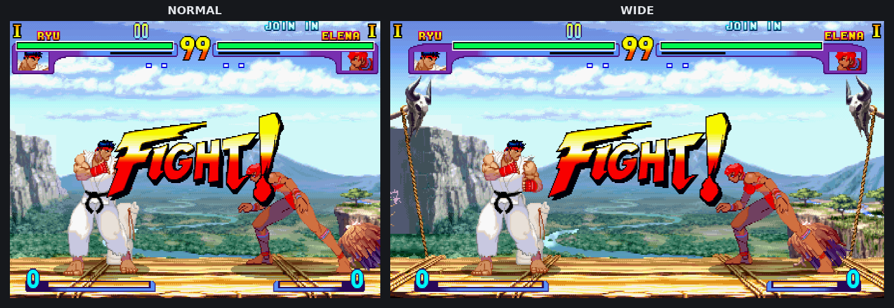
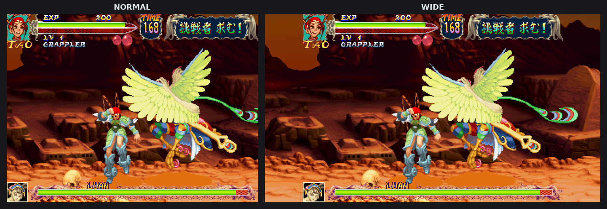
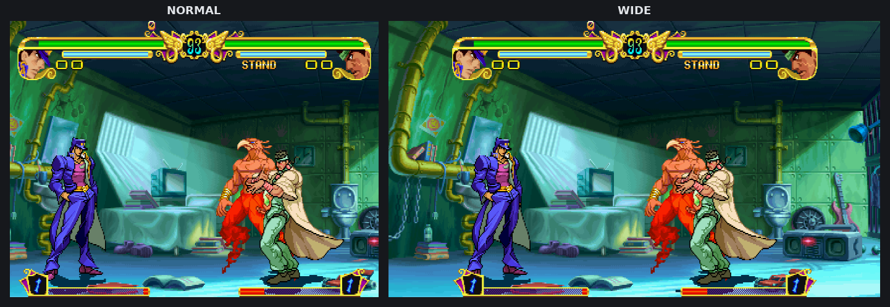
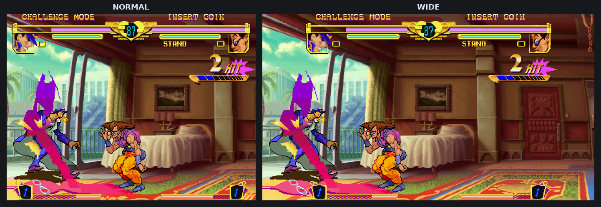
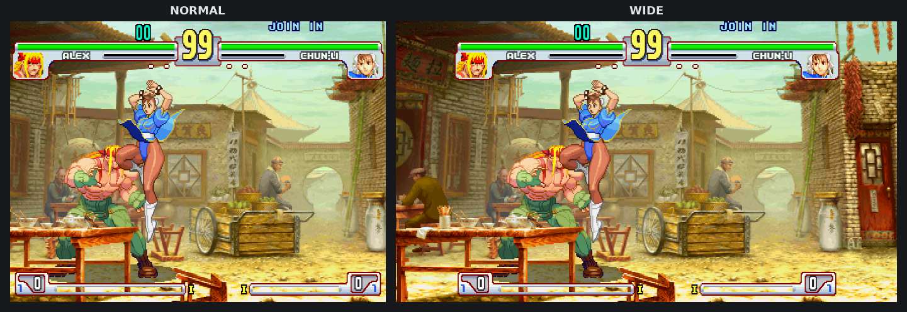
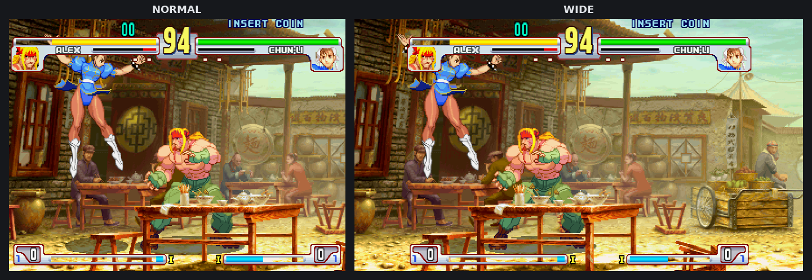
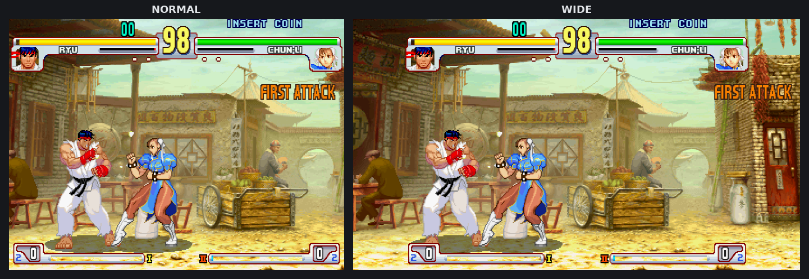

# CPS3 Widescreen

Widescreen (495 x 224) for seven Capcom CPS3 games, switched on and off from each game's own service menu with a
new SCREEN MODE setting. With the setting on NORMAL the Street Fighter III and JoJo games draw the same picture
as before, and so does Warzard since v1.3.0 (checked frame by frame in MAME against the unpatched games, through
scripted fights too).

The patch is applied to your own **Darksoft CPS-3 multi-game pack** (the 2021-01-09 or 2021-04-02 release).
From that one pack it can make any of three things:

| Output   | What you get                                                                   |
|----------|--------------------------------------------------------------------------------|
| darksoft | The patched pack, ready to flash to Darksoft UltraSIMM program and graphics SIMMs |
| mame     | MAME NO CD ROM sets, one folder per game                                       |
| mister   | MRA files and ROM zips for Jotego's CPS3 core (jtcps3) on MiSTer              |

No ROM data is included in this repository or its releases. You need the Darksoft pack, and for the MAME and
MiSTer outputs one MAME set of your own (see [What you need](#what-you-need)).

The easiest way is the app: download it, double-click it, choose your pack, click **Make files**. It runs on
Linux and on Windows, including under Wine, and has the instructions built in. See [The app](#the-app).

## Games

| Darksoft bank | Game                                              | Darksoft files patched          |
|---------------|---------------------------------------------------|---------------------------------|
| 0             | Street Fighter III: New Generation                | Standard SH2 and Custom SH2     |
| 1             | Warzard (Red Earth)                               | Standard SH2 and Custom SH2     |
| 3             | JoJo's Venture                                    | Standard SH2 only               |
| 4             | JoJo's Bizarre Adventure: Heritage for the Future | Standard SH2 only               |
| 5             | Street Fighter III 3rd Strike                     | Standard SH2 and Custom SH2     |
| 6             | Street Fighter III 3rd Strike: Makoto Fix         | Standard SH2 and Custom SH2     |
| 7             | Street Fighter III 4rd Strike                     | Standard SH2 and Custom SH2     |

Bank 2 (2nd Impact) is left as it is: it already has a widescreen option of its own. Darksoft's bank 3 and 4
Custom SH2 files hold different revisions of the two JoJo games, so those stay unpatched; on a Custom SH2
(security cart) board the JoJo games run in 4:3 as before.

What widescreen does:

- Fights show more of each stage on both sides.
- The fight HUD (life bars, timer, meters, score) is centered on the wider screen.
- In 3rd Strike, Makoto Fix and 4rd Strike, life and damage stay the same as in 4:3. (The game's own unfinished
  wide mode raises the life total, which also changes damage; the patch keeps the 4:3 value.)

## Screenshots

The same moment of the same scripted fight in each game, with SCREEN MODE on NORMAL (left) and on WIDE (right).
The pictures are MAME 0.289 snapshots of the patched games, shown the way a 4:3 and a 16:9 display show them.

**Street Fighter III: New Generation**



**Warzard (Red Earth)**



**JoJo's Venture**



**JoJo's Bizarre Adventure: Heritage for the Future**



**Street Fighter III 3rd Strike**



**Street Fighter III 3rd Strike: Makoto Fix**



**Street Fighter III 4rd Strike**



## What you need

- **The Darksoft CPS-3 pack**, `Darksoft CPS-3 2021-01-09.7z` or `Darksoft CPS-3 2021-04-02.7z` (or the folder
  you extracted it to: the one that holds `SIMM 1-2` and `SIMM 3-6`). See
  [The two Darksoft releases](#the-two-darksoft-releases) for how they differ.
- **For the MAME and MiSTer outputs:** your MAME `sfiii3nr1.zip` or `sfiii3n.zip` (3rd Strike, NO CD). Only its
  BIOS chip is used. If you also have `sfiiina`/`sfiiin`, `jojon`/`jojonr1`/`jojonr2` or
  `jojoban`/`jojobanr1`/`jojobanr2`, New Generation and the JoJo games use their own BIOS and their own MAME
  sets instead (see [MAME](#mame)).
- **About 3 GB of free disk space** for all three outputs (less for one).

## The app

Download from the [latest release](https://github.com/djanice1980/CPS3-widescreen/releases/latest):

| Your system | File |
|---|---|
| Linux (64-bit PC: Ubuntu 20.04, Debian 11, Fedora, Arch and newer) | `CPS3-Widescreen-linux-x86_64` |
| Windows 10 or 11 (64-bit), or Wine on Linux | `CPS3-Widescreen-windows-x64.exe` |

Nothing to install: each is a single file.

**Linux:** downloaded files are not allowed to run until you say so. In your file manager, right-click the file,
choose Properties, and on the Permissions tab tick "Allow executing file as program" (KDE: "Is executable"). Then
double-click it. (In a terminal: `chmod +x CPS3-Widescreen-linux-x86_64` and `./CPS3-Widescreen-linux-x86_64`.)

**Windows:** double-click the .exe. The app is not code-signed, so Windows may show "Windows protected your PC":
click **More info**, then **Run anyway**.

**Wine:** double-click the .exe if your desktop opens .exe files with Wine, or run
`wine CPS3-Widescreen-windows-x64.exe`. Your Linux files are on drive Z: in its file dialogs.

Then, in the app:

1. **Your Darksoft CPS-3 pack:** choose the .7z you downloaded (or the folder you extracted it to; only its
   `SIMM 1-2` and `SIMM 3-6` folders are read).
2. **What to make:** tick the Darksoft pack, MAME sets, MiSTer files, or any mix.
3. **Your MAME ROM folder** (MAME and MiSTer only): the folder that holds `sfiii3nr1.zip` or `sfiii3n.zip`.
4. **Save to:** an empty folder is best.
5. Click **Make files**. It takes a few minutes; **Open output folder** shows the results.

Everything is made in a work folder and moved into the output folder only when all of it is complete. If the app
stops for any reason (a wrong pack, no BIOS, a full disk, closing the window), the output folder is left as it
was and the message says what to fix.

The Instructions tab in the app covers flashing, turning widescreen on, MAME and MiSTer, the same as the sections
below.

## Command line (optional)

The app and `tools/make_pack.sh` do the same work with the same code (`tools/cps3ws.py`). To use the command line
you need **Python 3 with numpy, git, and 7-Zip**. Install them:

  Arch / CachyOS / Manjaro:
  ```bash
  sudo pacman -S --needed python python-numpy 7zip git
  ```
  Debian / Ubuntu / Mint:
  ```bash
  sudo apt install python3 python3-numpy p7zip-full git
  ```
  Fedora:
  ```bash
  sudo dnf install python3 python3-numpy p7zip p7zip-plugins git
  ```
  Windows: use WSL. In PowerShell run `wsl --install`, restart, open "Ubuntu" from the Start menu, and use the
  Debian / Ubuntu line above inside it. Your Windows drives are under `/mnt/c`, `/mnt/d` and so on, so a pack in
  your Downloads folder is `/mnt/c/Users/<your Windows user name>/Downloads/Darksoft CPS-3 2021-01-09.7z`.

  macOS has not been tried (the script uses GNU `realpath`); use Linux, WSL or a Linux VM.

  To check what you already have: `python3 -c "import numpy"` prints nothing when numpy is installed, and
  `7z` prints its version banner when 7-Zip is installed.

You do not need a compiler: the patches are prebuilt in `patches/`. (To build them yourself, see
[Building the patches from source](#building-the-patches-from-source).)

### Running make_pack.sh

Get the code, either with git:

```bash
git clone https://github.com/djanice1980/CPS3-widescreen.git
```

or by downloading the source zip from the [latest release](https://github.com/djanice1980/CPS3-widescreen/releases/latest)
and unzipping it. Then, from inside the `CPS3-widescreen` folder:

```bash
cd CPS3-widescreen
```

Run `tools/make_pack.sh <Darksoft pack> <output folder> --format <formats> [--roms <folder with your MAME sets>]`.
Replace the two paths in these examples with your own:

All three outputs:
```bash
tools/make_pack.sh ~/Downloads/"Darksoft CPS-3 2021-01-09.7z" out --format all --roms ~/mame/roms
```
Only the Darksoft pack (no MAME set needed):
```bash
tools/make_pack.sh ~/Downloads/"Darksoft CPS-3 2021-01-09.7z" out --format darksoft
```
Only MAME, or only MiSTer:
```bash
tools/make_pack.sh ~/Downloads/"Darksoft CPS-3 2021-01-09.7z" out --format mame --roms ~/mame/roms
```
```bash
tools/make_pack.sh ~/Downloads/"Darksoft CPS-3 2021-01-09.7z" out --format mister --roms ~/mame/roms
```

`--format` takes `darksoft`, `mame`, `mister` (several separated by commas) or `all`; without it you get
`darksoft`. `--roms` is the folder that holds your MAME zips (it can be given more than once). The run takes a
couple of minutes and needs about 3 GB of free space for `all`. Everything is made in `.cps3ws-work` inside the
output folder and moved into place when complete; a run that stops leaves the output folder as it was.

The tool checks every patched address against the bytes the patch expects and stops if any differ, so a
different or modified pack is refused. It also checks that the Custom
SH2 files decrypt back to the Standard ones and that every MAME set and MRA decodes back to the patched program.

You get, in the output folder:

```
Darksoft CPS-3 2021-01-09 - widescreen (...).zip   the patched Darksoft pack
MAME/                                               one folder per game, plus README.txt
MiSTer/_Arcade/_CPS3 Widescreen/*.mra               MiSTer MRA files
MiSTer/games/mame/*.zip                             their ROM zips, plus MiSTer/README.txt
```

## Turning widescreen on

Each game gets a SCREEN MODE item (NORMAL / WIDE) in its settings page of the test menu:

1. Enter the test menu (the TEST button on the board; F2 in MAME).
2. Open the game's settings page (the one with difficulty, rounds and so on).
3. Set SCREEN MODE to WIDE. In Warzard's Japanese menu it is スクリーンモード, ノーマル / ワイド.
4. Save and leave the test menu the way that game normally saves its settings (for New Generation that is item
   4, save and return). Warzard switches as soon as you save. If another game is still 4:3 after you leave the
   test menu, reset the machine (F3 in MAME).

The setting is stored in the game's EEPROM settings like any other option, so it survives power-off.

## The two Darksoft releases

Both work, and the tool tells you which one it was given. The 2021-04-02 release differs from 2021-01-09 in two
places, found by comparing the two packs bank by bank (everything else is byte-identical):

- **Warzard (bank 1):** `SIMM1_Jumper_U9_..._WarzardFIX.bin` changes one instruction, at 060024C0: a call to
  0600E864 becomes a no-op. That routine writes to 05140000, which is the CPS3's SCSI controller (the WD33C93 in
  MAME's CPS3 driver), so the call sends a command to the CD-ROM drive. A board running from Darksoft SIMMs has
  no CD-ROM drive; forum reports from the time call this release's change the Warzard no-CD fix. The widescreen
  patch does not touch that code and works with either release.
- **Makoto Fix (bank 6) graphics:** `SIMM 3-6` now has two SIMM 5 files instead of one:
  `SIMM5_Final_MakotoFIX.bin` (the Makoto Fix graphics, with a fix of its own) and `SIMM5_Final_reTHIRD.bin` (the
  reTHIRD mod). Both differ from 2021-01-09 only in bank 6, and the bank 6 program is the same for both. You
  flash one of them. The MAME and MiSTer outputs make both, as "Makoto Fix" and "Makoto Fix (reTHIRD)".

## Darksoft

Unzip the patched pack and flash it the same way you flash the original Darksoft pack, following Darksoft's
instructions for your UltraSIMM kit. Use the `Standard SH2` program files on a board with a standard
(HD6417095) SH2, and the `Custom SH2` files on a board that still uses the original security-cart CPU. Only the
program SIMM files (`SIMM 1-2`) differ from the original pack; `SIMM 3-6` are copied unchanged. With the
2021-04-02 pack, flash one of the two SIMM 5 files, as you would with the original.

## MAME

Each folder under `MAME/` is one game, stored as the MAME NO CD set named inside it. The files differ from
MAME's own sets, so MAME reports wrong checksums and then runs the game anyway.

Run a game with its folder as the ROM path **and its own nvram folder**:

```bash
mame -rompath "out/MAME/sfiii-3rd-strike" -nvram_directory "out/MAME/sfiii-3rd-strike/nvram" sfiii3nr1
```

The nvram folder matters. MAME saves CPS3 program SIMMs into `nvram/<set name>/` and boots from those copies
afterwards, so a game that shares an nvram folder with the unpatched game, or with another folder here that uses
the same set name, boots whichever program ran there first. `MAME/README.txt` lists the set name of each folder.

Set names:

- 3rd Strike is `sfiii3nr1`. Makoto Fix and 4rd Strike are `sfiii3n` (they are 3rd Strike hacks).
- Warzard is always `sfiii3n`. MAME's Red Earth machine has no second program SIMM, and that is where Warzard's
  widescreen code lives. Red Earth's inputs are the same as 3rd Strike's, so only the button names differ.
- New Generation and the JoJo games are `sfiiina`, `jojonr2` and `jojobanr2` when your `--roms` folder has a
  BIOS for that game. Without one they run as `sfiii3n` on the 3rd Strike BIOS. A CPS3 BIOS only works on its
  own game's MAME machine, so it cannot be moved to another set.
- The BIOS sets the region. On the 3rd Strike Japan BIOS, Warzard and the JoJo games show their Japanese
  versions.

## MiSTer

This is for Jotego's CPS3 core (`jtcps3`). Copy the output to the root of the MiSTer SD card (`/media/fat`):

- `MiSTer/_Arcade/_CPS3 Widescreen/` to `/media/fat/_Arcade/_CPS3 Widescreen/`
- `MiSTer/games/mame/*.zip` to `/media/fat/games/mame/`

The core itself must already be installed in `/media/fat/_Arcade/cores/`. While the core is in beta it also
needs Jotego's `jtbeta.zip` in `games/mame`, the same as his own CPS3 MRAs. Each MRA uses only its own zip
(`sfiii3w.zip`, `warzardw.zip` and so on), so your normal CPS3 zips are untouched, and its own setname, so the
saved settings are kept apart from the unpatched games.

The MRAs use the same header, ROM order and interleave as Jotego's published CPS3 MRAs. Given an unmodified
`sfiii3nr1` set, the generator reproduces the checksum Jotego publishes for it exactly.

## Status and known issues

- Tested in MAME 0.289: all seven games boot from all three outputs' data, and run in both modes. Not yet
  confirmed on a real CPS3 board or on a MiSTer. Reports are welcome in
  [Issues](https://github.com/djanice1980/CPS3-widescreen/issues).
- The apps: the Linux app ran end to end (all three outputs from the 2021-04-02 .7z) on Ubuntu 20.04 and opens on
  Ubuntu 24.04, Fedora 42 and Arch; its "Choose..." buttons were tested with the real desktop choosers (zenity on
  Ubuntu 24.04, kdialog on Arch). The Windows app ran end to end under Wine 11.22. Both gave the same files as
  the command line (the zips hold identical files; only their compression differs slightly). The Windows app has
  not been run on real Windows yet.
- The MAME sets made with a game's own BIOS (New Generation, JoJo) follow MAME's own layout for those sets but
  were not run here.
- Some non-fight screens (continue, game over, results, a few intro scenes) are still drawn at 4:3 width, with
  black side bars or an offset picture.
- 3rd Strike, Makoto Fix and 4rd Strike in WIDE: the label of a timed super art (such as Yun's Genei-Jin) now
  moves with the gauge, but this fix was not replayed in MAME (it needs that character with a full gauge). The
  bonus stage's score digits may still sit at their 4:3 column (seen in the source, not tried).
- **JoJo's Venture and JoJo HFTF on a real Darksoft board:** up to v1.1.1 the patch kept its variables on the RAM
  bytes the Darksoft versions of the games read at boot (region at 0207F000, no-CD flag at 0207F004), so the
  game ran the CD-ROM drive scan the flag exists to skip. Fixed in v1.2.0: the variables moved to 0207C000, and
  with the two bytes set as a Darksoft board has them the patched boot is identical to the unpatched one in
  MAME. It is still not confirmed on hardware.
- Warzard on NORMAL: up to v1.2.x all text went through a copy in RAM in both modes, which cost CPU time every
  frame; a few effects are timed by the game's idle loop, so some frames differed from the unpatched game and
  scripted fights played out differently. Since v1.3.0 the game's own text code runs untouched on NORMAL and
  only WIDE uses the copy. In MAME the patched game is now identical to the unpatched one on every sampled
  frame of a 9,000-frame scripted run that differed before (and its scheduler averages the same passes per
  frame, 338.3 against 338.4).
- At the edges of the wider view, some stage objects can appear a moment late.
- Stage ends in WIDE were checked in MAME by walking both players to each end of every stage: 3rd Strike,
  Makoto Fix and 4rd Strike (21 stages each), New Generation (19 stage backgrounds), Warzard (10), JoJo HFTF
  (37 stage numbers) and JoJo's Venture (30). What that found is fixed (see
  [What the patch changes](#what-the-patch-changes-in-each-game)). 3rd Strike, New Generation, Warzard and
  JoJo HFTF were also looked at zoomed in; Makoto Fix, 4rd Strike and JoJo's Venture, which share their
  stages with those, were checked by automatic scans for black blocks. Warzard's stages were forced in a
  two-player match, which is not how the game reaches all of them.
- JoJo's Venture and JoJo HFTF in WIDE, the bridge stage: at the two ends of the stage the fighters stop 40
  to 48 pixels short of the screen edge, because the picture cannot slide all the way to the stage end there
  (see the same section).

## Building the patches from source

`patches/` is generated; you only need this to change the patches. `--build` compiles everything from source
and refreshes `patches/` before making the outputs:

```bash
tools/make_pack.sh ~/Downloads/"Darksoft CPS-3 2021-01-09.7z" out --format all --build
```

On top of the requirements above it needs:

- **wine and make**, for the original Hitachi SHC compiler that builds 3rd Strike and New Generation code:
  Arch `sudo pacman -S --needed wine make`, Debian/Ubuntu `sudo apt install wine make`.
- **The two decompilation projects** by gibletto, in `vendor/`, at the commits this was built against:
  ```bash
  git clone https://github.com/gibletto/sfIII3-cps3-decomp vendor/sfIII3-cps3-decomp
  ```
  ```bash
  git -C vendor/sfIII3-cps3-decomp checkout d440837003292a6521f85f0c57752c7b5f30255b
  ```
  ```bash
  git clone https://github.com/gibletto/sfIII-cps3-decomp vendor/sfIII-cps3-decomp
  ```
  ```bash
  git -C vendor/sfIII-cps3-decomp checkout f9b0553a44bd15bf82b71290f29e3aebf3e33edd
  ```
- **Your MAME `sfiii3nr1.zip`** in `rom/` (the 3rd Strike build takes its graphics data from it).

## Building the apps

The release files are built from this repository, on Linux, with Docker (Linux app) and Wine (Windows app):

```bash
app/build_linux.sh
```
```bash
DISPLAY=:0 app/build_windows.sh
```

`build_linux.sh` builds in a Debian 11 container (so the app runs on glibc 2.31 and newer). `build_windows.sh`
sets up its own Wine prefix in `build/wine-app` with the official Windows Python 3.12.10 from python.org (MD5
checked) and PyInstaller, numpy and py7zr from PyPI. Both write to `build/app/`. `app/test_linux.sh` and
`app/test_windows.sh` run the built apps on a virtual display (Xvfb in a container), fill in the form, make the
files and save a screenshot, without opening windows on your desktop. `PICK=zenity` or `PICK=kdialog` with
`app/test_linux.sh` also presses a real "Choose folder..." button and accepts the desktop chooser that opens. To run the app from source instead:
`python3 app/cps3ws_app.py` (needs python3-tk and numpy, plus py7zr or 7z for .7z packs).

## What the patch changes in each game

How each patched game differs from the game in the Darksoft pack. With SCREEN MODE on NORMAL every game draws
what the unpatched game draws; the differences below show in WIDE, apart from the new menu item.

### All seven games

- **A SCREEN MODE item** (NORMAL / WIDE) on the game settings page of the test menu, in the English and the
  Japanese menus, saved with the game's other settings.
- **The memory test still passes:** the checksum byte of each program SIMM is set so the SIMM's sum is what it
  was.
- **Darksoft Custom SH2 files:** new instructions are stored encrypted the way Darksoft stores the rest of each
  bank.

### Street Fighter III: New Generation

New Generation still contains its complete original wide mode. Only its menu item was gone.

- **Menu:** the GAME CONFIGURATION page is the game's own page again with SCREEN MODE as item 6 and EXIT as
  item 7. The item uses the game's own routine and strings.
- **One stage end (new in v1.4.0):** on stage 6, at the left end, the first screen column was black on the top
  30 lines in WIDE. One scroll limit value is changed by one pixel so the view stops before it.
- **Nothing else is changed.** The fight, the HUD, the other stage limits and the effects in WIDE are the
  game's own.

### Street Fighter III 3rd Strike, Makoto Fix and 4rd Strike

3rd Strike has a leftover wide mode that no menu reaches and that was never finished. The patch turns it on and
finishes the parts that were visibly wrong. The three programs are patched with the same code: it is compiled
from gibletto's byte-matching decompilation with the original compiler, then relinked to the addresses of the
Makoto Fix and 4rd Strike programs.

- **Menu:** SCREEN MODE is item 8 of the GAME CONFIGURATION page and EXIT moves to item 9. 3rd Strike's
  Japanese menu font no longer has the character needed for "wide", so the patch makes one from another glyph.
- **Life bars and damage:** the leftover wide mode raises full life from 160 to 192 while the life bars are
  still drawn for 160, so a bar does not move until a sixth of the life is gone, and damage is scaled
  differently. The patch keeps 160, so life and damage in WIDE are the same as in 4:3.
- **Fight HUD centered:** in the leftover wide mode the life bars, timer, stun gauges, names, portraits and
  super art gauges stay in the left 384 pixels of the 496-pixel screen. The patch replaces 25 HUD routines
  with copies that draw 7 text columns (56 pixels) further right. Score, win marks, combo counters and the
  INSERT COIN text are left alone, because the game already places those by screen mode.
- **Messages centered:** the same for the pictures in the middle of the screen (K.O., YOU WIN, YOU LOSE,
  PERFECT, TIME OVER, DRAW GAME), the "here comes a new challenger" banner and the screen clear at the end of
  a match.
- **Stage ends (new in v1.4.0):** the game's own wide-mode scroll limits let the view go past the end of the
  artwork on five stages, which showed as a blank block at the screen edge when the view reached that end.
  Six limit values are corrected so the view stops where the artwork ends:

  | Stage | End | What showed before |
  |---|---|---|
  | Chun-Li's | left | 26 pixels with no artwork, the lower half black |
  | Russia, night | left | 40 black pixels, full height |
  | Castle roof | right | 9 black pixels on the upper part |
  | Castle roof | left | the tree cut off 7 pixels early |
  | Subway, day and night | right | 6 black pixels where the train ends |

  On the savanna stage (Elena's) the backdrop itself was 4 pixels short at the left end, which a scroll limit
  cannot hide: the backdrop scrolls a sixteenth as fast as the floor. Since v1.4.1 the routine that places it
  holds it still for the last stretch in WIDE.

  The game uses these values only in WIDE, so NORMAL is not affected. The unpatched game shows the same
  blocks when its leftover wide mode is forced on (checked on Chun-Li's stage). In WIDE the view's travel
  is shorter by 10 to 40 pixels at each corrected end; every one of these stages is still at least as wide
  in WIDE as in 4:3.

### JoJo's Venture and JoJo's Bizarre Adventure: Heritage for the Future

These games have no wide mode. There is no decompilation of them, so the patch was written against the
machine code, with the addresses found by tracing the games in MAME.

- **Display:** WIDE switches the board to its 496-pixel screen mode, the one 3rd Strike uses.
- **Sprites and backgrounds:** everything is moved through the game's own horizontal offset, the one its
  screen shake uses. Outside fights the 4:3 picture sits in the middle of the wider screen. In a fight the
  wider view follows the camera and stops at the stage edges, so the extra width shows stage and never what
  lies past its end.
- **HUD, menus and messages:** these are all on the text layer, which the hardware cannot shift right by the
  needed 56 pixels. In WIDE the game's text routines run from copies that draw into a buffer in RAM, and once
  a frame the buffer is copied to the screen 7 columns further right. A short dispatcher at each text routine
  picks the original or the copy by the screen mode.
- **The bridge stage (new in v1.4.1):** this stage draws its background only in a window of about 520 pixels
  around the 4:3 view, where every other stage is drawn end to end. At the stage's two ends the wider view ran
  out of that window and showed a black block 31 to 48 pixels wide. On this stage the view now stays inside
  the window, so at the ends it shows a little of what the game draws past the 4:3 edge, and the fighters stop
  40 to 48 pixels short of the screen edge.
- **Menu:** SCREEN MODE is added to the game settings list before EXIT. It is read at boot, so it takes
  effect after a reset.
- **Memory check:** when a SIMM fails the game halts on purpose; in WIDE the last results are now drawn before
  that halt.
- **Fights play as in 4:3:** the camera, the stage limits and the collisions are untouched. Only what is drawn
  moves.

### Warzard (Red Earth)

Warzard has no wide mode either and is patched the same way as the JoJo games, with these differences.

- **Where the code lives:** the patch's code is in program SIMM 2, which the 8 MB game does not use itself.
- **Sprites and backgrounds:** the horizontal offset is changed only while the game writes the scroll
  registers in the vertical blank, so the game's own logic never sees it.
- **Backdrops that do not scroll (new in v1.4.1):** some stages have a background layer that stays put while
  the floor scrolls. The patch used to slide it with everything else, and on the ice stage the sky ran out of
  picture: a black block up to 48 pixels wide in the top third of the screen at the stage's ends. Such layers
  now stay centered.
- **The view is held at the stage ends on every stage (new in v1.4.1):** two stages (the bonus stage with the
  statue and the stage with the stone faces) move their view through different code from the other eight, and
  the patch did not hold the wider view at their ends: it ran 56 pixels past each end. On the bonus stage the
  artwork also stops short of the stage's right end, and a 27-pixel slice of the left wall showed on the right
  edge of the screen. The view now stops at the ends on these two stages as well, and on the bonus stage where
  the artwork stops. It also stays put after a K.O.; before, the picture slid back to the middle once the
  fight was over.
- **Text on NORMAL:** the game's own text code runs untouched (since v1.3.0); only WIDE uses the copy.
- **Menu:** SCREEN MODE is on both the English and the Japanese settings page, and the width changes as soon
  as the setting is saved. The Japanese font has no character for "wide" here either, so the patch makes one.
- **Memory check:** each line appears as it is printed, in both modes.

## License

Copyright (C) 2026 David Janice

This program is free software: you can redistribute it and/or modify it under the terms of the GNU Affero
General Public License as published by the Free Software Foundation, version 3. It is distributed WITHOUT ANY
WARRANTY; see [LICENSE](LICENSE) for the full terms.

If you reuse or adapt this code, keep this copyright notice and credit this project, and release your version
under the same license with its source.

The license covers this project's own code and patches only. It grants no rights to Capcom's games, ROM data or
trademarks. The 3rd Strike family and New Generation code is built on gibletto's decompilations, which are
themselves AGPL-3.0.

## Credits

- [gibletto](https://github.com/gibletto)'s 3rd Strike and New Generation decompilations and rebuilt SHC
  toolchain, which the 3rd Strike family and New Generation patches are built from (AGPL-3.0). Parts of those
  were ported from [crowded-street/3s-decomp](https://github.com/crowded-street/3s-decomp).
- [Jotego](https://github.com/jotego/jtcores)'s CPS3 core, whose published MRAs define the MiSTer layout.
- MAME's CPS3 driver, for the decryption keys and ROM layout.
- Darksoft, for the multi-game kit and pack these patches target.

Street Fighter, JoJo's Venture, JoJo's Bizarre Adventure, Warzard and Red Earth are trademarks of Capcom (JoJo's
Bizarre Adventure under license from Hirohiko Araki / Shueisha). This project is not affiliated with Capcom,
Darksoft or Jotego and contains none of their ROM data.
